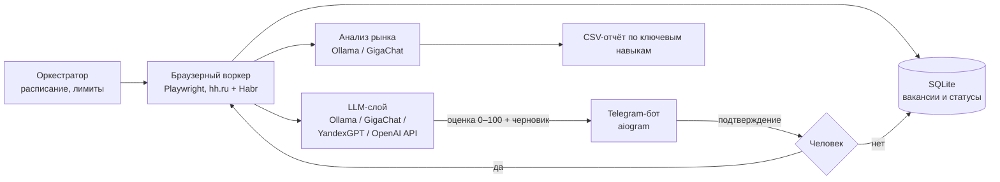

# hh-agent — агент поиска работы с LLM-оценкой вакансий

Агент мониторит новые вакансии на hh.ru и Habr Career, оценивает их релевантность резюме с помощью LLM, готовит черновик сопроводительного письма и присылает его в Telegram. Отклик уходит только после подтверждения человеком. Отдельный модуль анализирует рынок: LLM выписывает ключевые навыки из полных текстов вакансий и считает, что работодатели требуют чаще всего.

## Архитектура



## Что внутри

- **Human-in-the-loop.** Агент ничего не отправляет сам: черновик приходит в Telegram с кнопками, статус вакансии проходит путь new → notified → confirmed → sent (или skipped). Дневной лимит откликов и рабочие часы задаются в `.env`.
- **LLM-оценка.** Модель получает резюме и полный текст вакансии и возвращает JSON: оценку релевантности 0–100, обоснование и письмо. Ответ проходит постобработку: восстановление битого JSON, удаление плейсхолдеров вида «[Имя HR]», правка ИИ-штампов, проверка фамилии.
- **Модели.** Слой `llm/providers/`: один интерфейс и четыре реализации — локальная Ollama (qwen2.5:7b, контекст 8192 токена), GigaChat (каскад моделей и классификация ошибок API), YandexGPT и любой OpenAI-совместимый API. Модель выбирается строкой `LLM_PROVIDER` в `.env`. Повторы при сбоях сети и лимитах, учёт токенов по каждому вызову. Межпроцессная блокировка не даёт двум агентам (hh и Habr) одновременно нагружать одну локальную модель.
- **Анализ рынка.** `analyze_market.py` проходит все страницы выдачи, сохраняет полные тексты вакансий и с помощью LLM (плюс словарь как страховка) выписывает ключевые навыки; ответы модели кэшируются в БД.
- **Тесты.** `test/` — pytest на отклик, разбор чатов, извлечение ключевых слов, схему ответа модели и слой провайдеров (HTTP и SDK подменены заглушками, сеть не нужна).

Архитектура описана в техдоке до начала разработки: `docs/tech_doc.md`.

## Стек

Python · asyncio · Playwright · SQLAlchemy (async) · Pydantic · Ollama · GigaChat API · YandexGPT API · httpx · aiogram · pytest

## Запуск

```
python -m venv venv
venv\Scripts\activate
pip install -r requirements.txt
playwright install chromium
copy env.template .env            # токен Telegram-бота, chat id, параметры поиска
copy resume.example.txt resume.txt  # вставить своё резюме
ollama pull qwen2.5:7b
python main_hh.py
```

Тесты (без сети, браузера и запущенной модели):

```
pip install -r requirements-dev.txt
python -m pytest
```

## Ограничения

Агент работает под сессией пользователя с осторожными лимитами и не обходит защиту площадки. Массовая рассылка откликов не поддерживается намеренно.
